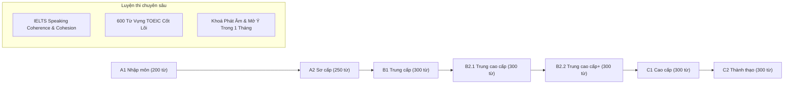
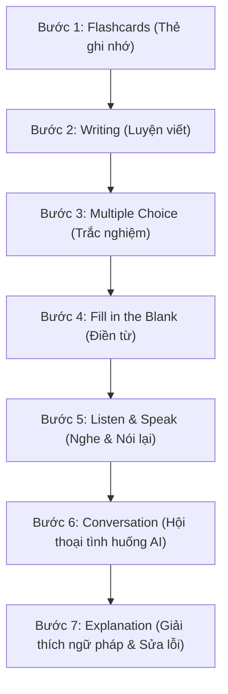

# BÁO CÁO PHÂN TÍCH KỸ THUẬT TOÀN DIỆN OPENQUIZ.AI (PHẦN 2)
## CÁC LỘ TRÌNH HỌC, CHỨNG CHỈ QUỐC TẾ & QUY TRÌNH BÀI HỌC 7 BƯỚC

---

## 1. HỆ THỐNG KHÓA HỌC CHUẨN HÓA THEO KHUNG THAM CHIẾU CEFR

Mỗi khóa học trong hệ thống OpenQuiz được thiết kế thành một lộ trình hoàn chỉnh chia nhỏ thành các **Phần (Parts)** và **Bài học (Lessons)**:



### 1.1. Chi tiết các khóa học Tiếng Anh tổng quát:
1. **Khoá A1 – Nhập môn**:
   - Quy mô: 200 từ vựng cốt lõi, 30 bài học.
   - Mục tiêu: Làm quen với phiên âm IPA, các từ vựng sinh hoạt hàng ngày, chào hỏi, số đếm, gia đình, thời gian.
   - Đầu ra: Có thể tự giới thiệu bản thân và hiểu các câu giao tiếp căn bản nhất.
2. **Khoá A2 – Sơ cấp**:
   - Quy mô: 250 từ vựng, 30 bài học.
   - Mục tiêu: Mô tả sở thích, trường học, mua sắm, chỉ đường, thời tiết. Bắt đầu ghép câu hoàn chỉnh.
3. **Khoá B1 – Trung cấp**:
   - Quy mô: 300 từ vựng, 30 bài học.
   - Mục tiêu: Giao tiếp tại công sở, du lịch, diễn đạt quan điểm cá nhân, kế hoạch tương lai, giải quyết các tình huống phát sinh thường gặp.
4. **Khoá B2.1 & B2.2 – Trung cao cấp**:
   - Quy mô: 600 từ vựng (300 từ mỗi chặng), 60 bài học.
   - Mục tiêu: Thảo luận các chủ đề xã hội, công nghệ, môi trường, kinh doanh. Phản xạ câu ghép và thành ngữ (idioms) tự nhiên.
5. **Khoá C1 & C2 – Cao cấp & Thành thạo**:
   - Quy mô: 600 từ vựng học thuật cao cấp, 60 bài học.
   - Mục tiêu: Sử dụng từ ngữ tinh tế, chính xác trong đàm phán, viết luận học thuật, hùng biện và phân tích văn bản phức tạp.

---

## 2. CÁC LỘ TRÌNH LUYỆN THI CHỨNG CHỈ QUỐC TẾ

### 2.1. Lộ trình IELTS Speaking: Coherence & Cohesion (Band 4.5 – 7.5+)
- **Đặc trưng**: Khóa học chuyên sâu giúp nâng band từ 3.0–4.0 lên 5.5–7.0+ theo phương pháp độc quyền **"Nói trước – Học sau"**.
- Gồm **6 phần lớn** và **30 bài học chuyên đề**, tập trung vào:
  - Các liên từ mở ý (Linking devices / Discourse markers).
  - Từ vựng nâng cao thay thế cho các từ cơ bản (Paraphrasing).
  - Kỹ thuật kéo dài câu trả lời trong Part 1, cách phát triển dàn ý 2 phút cho Part 2 và lập luận phản biện cho Part 3.

### 2.2. Lộ trình 600 Từ vựng TOEIC Thiết Yếu
- Chia thành 50 bài học ứng với 50 ngữ cảnh bài thi TOEIC: Hợp đồng (Contracts), Tiếp thị (Marketing), Bảo hiểm (Insurance), Đặt chỗ (Reservations), Hội nghị (Conferences), Kế toán (Accounting).
- Mỗi bài có bài kiểm tra nghe chính tả và bài tập đọc điền từ mô phỏng sát Part 5 & Part 6 của đề thi TOEIC thật.

### 2.3. Lộ trình Tiếng Trung (HSK 1 đến HSK 6)
- **HSK 1**: 150 từ vựng căn bản + Pinyin + quy tắc nét viết Hán tự.
- **HSK 2**: 300 từ vựng giao tiếp thực hành.
- **HSK 3**: 600 từ vựng trung cấp, hội thoại mua sắm, làm việc.
- **HSK 4**: 1,200 từ vựng đọc hiểu báo chí cơ bản.
- **HSK 5**: 2,500 từ vựng thảo luận thời sự, thuyết trình.
- **HSK 6**: 5,000 từ vựng cao cấp, dịch thuật chuyên nghiệp.

### 2.4. Lộ trình Tiếng Hàn (TOPIK I & TOPIK II)
- **TOPIK I (Level 1–2)**: 40 bài học, 1,000 từ vựng sinh hoạt hàng ngày tại Hàn Quốc.
- **TOPIK II (Level 3–4)**: 60 bài học, 2,000 từ vựng trung cấp công sở.
- **TOPIK II (Level 5–6)**: 80 bài học, 3,500 từ vựng học thuật, kinh tế, xã hội.

### 2.5. Lộ trình Tiếng Nhật (JLPT N5 đến JLPT N1)
- **JLPT N5**: 800 từ vựng + 100 chữ Kanji căn bản.
- **JLPT N4**: 1,500 từ vựng + 300 chữ Kanji.
- **JLPT N3**: 3,000 từ vựng + 650 chữ Kanji trung cấp.
- **JLPT N2**: 6,000 từ vựng + 1,000 chữ Kanji cao cấp cho công việc.
- **JLPT N1**: 10,000 từ vựng + 2,000 chữ Kanji đỉnh cao.

---

## 3. QUY TRÌNH SƯ PHẠM BÀI HỌC 7 BƯỚC (7-STEP LESSON FLOW)

Trong OpenQuiz, khi học sinh mở một bài học tại route `/courses/:level/part/:partNum/lesson/:lessonNum`, bài học không phải là một danh sách từ tĩnh mà là một quy trình tương tác 7 bước nghiêm ngặt:



### Chi tiết hành động tại từng bước:

| Bước | Tên bước trong mã nguồn | Mục tiêu nhận thức | Cơ chế tương tác |
| :--- | :--- | :--- | :--- |
| **1** | `stepFlashcards` | Nhận diện mặt chữ & âm thanh | Lật thẻ 3D, nghe audio bản xứ, xem hình ảnh minh họa và phiên âm IPA |
| **2** | `stepWriting` | Trí nhớ chủ động (Active Recall) | Màn hình hiển thị nghĩa tiếng Việt, học sinh phải tự gõ chính xác từng ký tự tiếng Anh |
| **3** | `stepMultipleChoice` | Tốc độ phản xạ | Câu hỏi trắc nghiệm 4 đáp án với bộ đếm thời gian (timer), chọn đáp án đúng trong 10 giây |
| **4** | `stepFillBlank` | Ứng dụng từ trong câu | Cho một câu ngữ cảnh khuyết từ, học sinh chọn hoặc gõ dạng chia đúng của từ vào chỗ trống |
| **5** | `stepListenSpeak` | Khẩu hình & phát âm chuẩn | Hệ thống phát âm mẫu câu, học sinh bật micro đọc lại. Thuật toán phân tích phổ âm thanh so khớp với mẫu |
| **6** | `activityConversation` | Phản xạ đàm thoại với AI | AI đóng vai trò đối thoại (bồi bàn, đồng nghiệp, giám khảo IELTS...), đặt câu hỏi bắt buộc học sinh phải dùng từ vừa học để trả lời |
| **7** | `activityExplain` | Đúc kết & củng cố ngữ pháp | AI phân tích toàn bộ câu trả lời ở Bước 6: chỉ ra từ dùng sai ngữ cảnh, lỗi chia thì, đồng thời đề xuất cách diễn đạt tự nhiên hơn |

---

## 4. CẤU TRÚC DỮ LIỆU CỦA MỘT BÀI HỌC (LESSON DATA SCHEMA)

```typescript
export interface CourseLesson {
  id: string;
  courseLevel: 'A1' | 'A2' | 'B1' | 'B2_1' | 'B2_2' | 'C1' | 'C2' | 'IELTS';
  partNumber: number;
  partTitle: string;
  lessonNumber: number;
  lessonTitle: string;
  targetVocab: {
    term: string;
    definition: string;
    ipa: string;
    partOfSpeech: string;
    example: string;
    audioUrl?: string;
  }[];
  grammarFocus: {
    ruleTitle: string;
    explanation: string;
    examples: string[];
  };
  conversationScenario: {
    roleAi: string;
    roleUser: string;
    context: string;
    initialPrompt: string;
    mandatoryWords: string[];
  };
}
```

