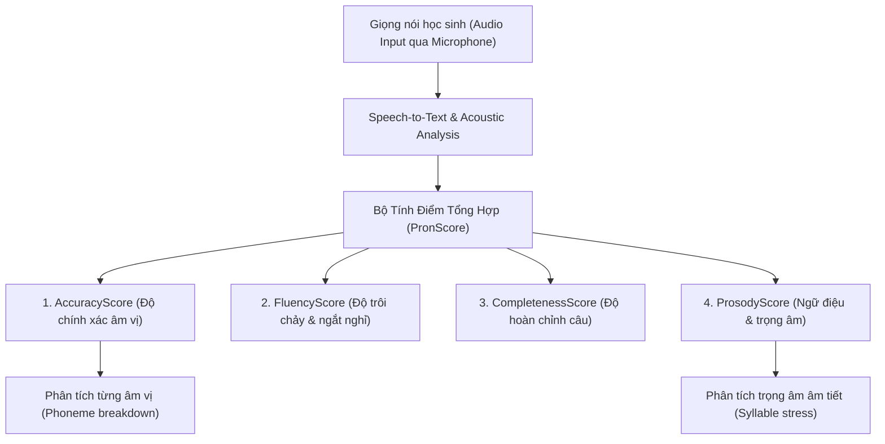

# BÁO CÁO PHÂN TÍCH KỸ THUẬT TOÀN DIỆN OPENQUIZ.AI (PHẦN 3)
## HỆ THỐNG TRÍ TUỆ NHÂN TẠO (AI) & CHẤM ĐIỂM PHÁT ÂM PRONSCORE

---

## 1. KIẾN TRÚC ĐỘC QUYỀN CHẤM ĐIỂM PHÁT ÂM (PRONSCORE ENGINE)

Hệ thống PronScore trong OpenQuiz được cấu thành từ 4 chỉ số phụ then chốt theo thang điểm từ 0 đến 100:



### 1.1. Giải thích chi tiết 4 chỉ số:
1. **AccuracyScore (Độ chính xác phát âm)**:
   - Đánh giá mức độ tiệm cận giữa âm thanh thực tế học viên phát ra so với âm thanh mẫu của người bản ngữ.
   - Phân tích chi tiết đến từng **Âm vị (Phoneme)** trong từ. Ví dụ: từ `resilient` /rɪˈzɪliənt/ nếu học viên đọc âm `/z/` thành `/s/`, hệ thống sẽ gắn nhãn `Mispronunciation` tại âm vị đó và trừ điểm.
2. **FluencyScore (Độ trôi chảy)**:
   - Đo lường khoảng cách thời gian giữa các từ, độ ngắt nghỉ tự nhiên, số lần ngập ngừng (hesitations, "uhm", "err").
   - Người nói câu liên tục với tốc độ từ 110–140 từ/phút (WPM) đạt điểm tối đa.
3. **CompletenessScore (Độ hoàn chỉnh)**:
   - Đo lường tỷ lệ các từ trong câu mẫu đã được học viên đọc đầy đủ, không bị nuốt âm hoặc bỏ quên từ cuối câu.
4. **ProsodyScore (Ngữ điệu & Trọng âm)**:
   - Đo sự lên xuống của cao độ giọng nói (pitch variation), độ nhấn nhá ở các từ mang nội dung chính (content words) và hạ giọng ở cuối câu trần thuật.

### 1.2. Cấu trúc dữ liệu JSON trả về của PronScore:
```json
{
  "pronScore": 86,
  "accuracyScore": 88,
  "fluencyScore": 79,
  "completenessScore": 93,
  "prosodyScore": 82,
  "words": [
    {
      "word": "resilient",
      "score": 91,
      "syllables": [
        { "syllable": "re", "score": 95, "stress": 0 },
        { "syllable": "sil", "score": 92, "stress": 1 },
        { "syllable": "i", "score": 88, "stress": 0 },
        { "syllable": "ent", "score": 89, "stress": 0 }
      ],
      "phonemes": [
        { "phoneme": "r", "score": 95 },
        { "phoneme": "ɪ", "score": 90 },
        { "phoneme": "z", "score": 91 }
      ]
    },
    {
      "word": "strategy",
      "score": 84,
      "syllables": [
        { "syllable": "strat", "score": 88, "stress": 1 },
        { "syllable": "e", "score": 82, "stress": 0 },
        { "syllable": "gy", "score": 82, "stress": 0 }
      ]
    }
  ]
}
```

---

## 2. HỆ THỐNG HỘI THOẠI AI TƯƠNG TÁC (AI CONVERSATION & ROLEPLAY)

Trong các route `/conversation/:id` và `/conversation/:id/:threadId`, OpenQuiz cung cấp các buổi đàm thoại nhập vai tình huống thực:

### 2.1. Cơ chế hoạt động:
1. **Thiết lập ngữ cảnh (Context & Persona)**:
   - AI nhận kịch bản đóng vai: Ví dụ: *Nhân viên tuyển dụng phỏng vấn ứng viên*, *Bác sĩ hỏi bệnh nhân*, hoặc *Giám khảo IELTS hỏi về môi trường*.
2. **Ép từ vựng mục tiêu (Mandatory Vocabulary Constraint)**:
   - Học viên được yêu cầu trả lời câu hỏi và **bắt buộc** phải sử dụng ít nhất 2 đến 3 từ vựng trong danh sách đang học (ví dụ: `resilient`, `breakthrough`, `perseverance`).
3. **Phân tích ngữ pháp tức thì (Real-time Grammar Coach)**:
   - Sau khi học viên gửi tin nhắn thoại hoặc gõ văn bản, AI sẽ thực hiện:
     - Kiểm tra sự xuất hiện của từ bắt buộc.
     - Kiểm tra chia thì và hòa hợp chủ vị (Subject-Verb Agreement).
     - Đưa ra phản hồi hóm hỉnh, thân thiện (ví dụ: *"did not gave?? Bạn vừa chia quá khứ 2 lần trong 1 câu — chọn một thôi nhé 😅"*).
     - Cung cấp gợi ý chuẩn mực bản xứ (*Native Suggestion*).

---

## 3. TÍNH NĂNG ĐỌC HIỂU TƯƠNG TÁC (AI READING & INSTANT VOCAB LOOKUP)

Tại route `/reading/:id`:
- Hệ thống hiển thị bài đọc phân theo độ khó Lexile / CEFR.
- **Tương tác click-to-lookup (`VocabularyLookupDialog`)**:
  - Học sinh chạm/nhấp vào bất kỳ từ vựng nào trong bài đọc, một popover tức thì hiện lên với:
    - Phiên âm IPA.
    - Nghĩa dịch ngữ cảnh trong câu đó.
    - Nút phát âm audio.
    - Nút **"Lưu vào sổ từ vựng cá nhân (+ Save to Word Bank)"**.
  - Toàn bộ từ được lưu sẽ tự động chuyển sang route `/user-words` để học sinh ôn tập bằng SRS.

---

## 4. TÍNH NĂNG AI GENERATION TỰ SINH HỌC PHẦN (AI SET GENERATOR)

Tại route `/create-flashcard`:
- Người dùng không cần phải tra từ điển và gõ từng từ thủ công.
- **3 chế độ sinh từ thông minh**:
  1. **Theo chủ đề (By Topic/Prompt)**: Nhập *"15 từ vựng tiếng Anh chuyên ngành Logistics"* $\rightarrow$ AI tự động sinh danh sách 15 từ, phiên âm, định nghĩa tiếng Việt, câu ví dụ thực tế và từ loại.
  2. **Trích xuất từ văn bản (From Text/Article)**: Dán một đoạn văn bản tin tức hoặc bài thi IELTS $\rightarrow$ AI quét và lọc ra các từ vựng khó từ band 6.5 trở lên để tạo bộ thẻ.
  3. **Tự động dịch song ngữ**: Nhập danh sách từ tiếng Anh thô $\rightarrow$ AI tự động bổ sung IPA và dịch nghĩa tương ứng.

