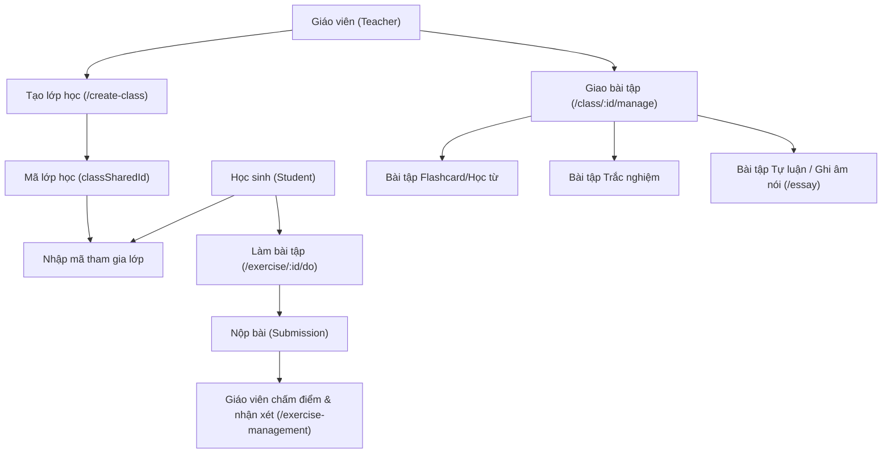
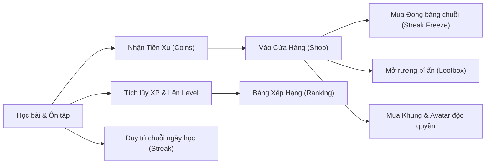

# BÁO CÁO PHÂN TÍCH KỸ THUẬT TOÀN DIỆN OPENQUIZ.AI (PHẦN 4)
## HỆ THỐNG QUẢN LÝ LỚP HỌC (LMS) & CƠ CHẾ GAMIFICATION (SHOP, STREAK, LOOTBOX)

---

## 1. HỆ THỐNG QUẢN LÝ LỚP HỌC DÀNH CHO GIÁO VIÊN & HỌC SINH (LMS)

Hệ thống LMS của OpenQuiz cho phép giáo viên biến nền tảng thành một trường học trực tuyến thu nhỏ:

### 1.1. Các loại hình bài tập (Assignment Types):
1. **Bài tập ghi nhớ từ vựng**:
   - Giáo viên chọn một học phần hoặc lộ trình học và đặt mục tiêu: *Học sinh phải thành thạo ít nhất 80% số từ trước ngày hết hạn (Deadline)*.
2. **Bài tập trắc nghiệm & điền từ**:
   - Tự động chấm điểm ngay khi học sinh nộp bài.
3. **Bài tập ghi âm nói & tự luận (`EssayExercise` & `SubmissionRecordings`)**:
   - Học sinh thu âm câu trả lời trực tiếp hoặc tải file ghi âm lên.
   - Hệ thống tự động bóc băng (transcribe) bản ghi âm thành văn bản và chạy PronScore sơ bộ.
   - Giáo viên nghe lại bản ghi âm, nhập điểm số (`teacher_score`) và để lại lời nhận xét chi tiết (`teacher_comment`).

### 1.2. Thư viện bài tập tái sử dụng (`ExerciseLibrary`):
- Giáo viên có thể lưu các bài tập xuất sắc vào thư viện cá nhân để tái sử dụng cho các khóa học hoặc lớp học tiếp theo chỉ với một cú nhấp chuột.

---

## 2. HỆ THỐNG GAMIFICATION & KINH TẾ TIỀN ẢO TRONG ỨNG DỤNG

OpenQuiz giữ chân hơn 120,000 người dùng hàng tháng nhờ cơ chế Gamification được thiết kế sâu sắc:

### 2.1. Chuỗi ngày học liên tục (Streak System):
- Học ít nhất 1 bài học mỗi ngày để tăng Streak thêm 1 ngày.
- Các cột mốc nhận thưởng lớn: 3 ngày, 7 ngày, 14 ngày, 30 ngày, 100 ngày và 365 ngày.
- **Streak Freeze (`freeze_v2`)**:
  - *Freeze thông thường (Regular Freeze)*: Bảo vệ chuỗi ngày nếu người dùng bận rộn quên học trong 24 giờ.
  - *Freeze tối thượng (Ultimate Freeze)*: Tự động kích hoạt khi vắng mặt tối đa 3 ngày mà không bị mất chuỗi.

### 2.2. Tiền xu thưởng (Coins) & Cửa hàng vật phẩm (Shop):
- Người dùng kiếm Xu thông qua:
  - Hoàn thành bài học 7 bước (+10 Xu).
  - Đạt điểm PronScore từ 85 trở lên (+5 Xu).
  - Duy trì chuỗi ngày học (+20 Xu mỗi tuần).
- Sử dụng Xu trong Shop tại route `/shop`:
  - Mua lượt Đóng băng chuỗi (50 Xu).
  - Mở Rương Lootbox (100 Xu) để trúng ngẫu nhiên: Huy hiệu VIP, Avatar động, khung viền danh hiệu, hoặc nhân đôi điểm kinh nghiệm trong 24 giờ.

### 2.3. Bảng xếp hạng học tập (Ranking Page):
- Phân chia giải đấu tương tự Duolingo: Hạng Đồng $\rightarrow$ Hạng Bạc $\rightarrow$ Hạng Vàng $\rightarrow$ Hạng Kim Cương $\rightarrow$ Hạng Quán Quân.
- Cạnh tranh theo điểm XP hàng tuần giữa 30 học viên cùng bảng đấu.

