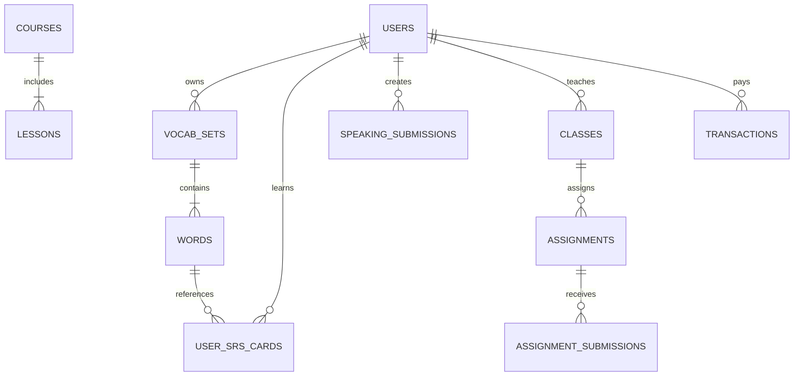

# BÁO CÁO PHÂN TÍCH KỸ THUẬT TOÀN DIỆN OPENQUIZ.AI (PHẦN 5)
## THIẾT KẾ BACKEND API & CƠ SỞ DỮ LIỆU ĐẦY ĐỦ (DÀNH CHO CODEX LẬP TRÌNH BE)

Tài liệu này được biên soạn chuẩn hóa để bạn có thể chuyển giao trực tiếp cho **Codex** hoặc đội ngũ lập trình Backend triển khai hệ thống (Node.js/Express/NestJS/FastAPI/Go + PostgreSQL/MongoDB).

---

## 1. THIẾT KẾ CƠ SỞ DỮ LIỆU (DATABASE SCHEMA)



### 1.1. Bảng `users` (Người dùng)
| Trường | Kiểu dữ liệu | Ràng buộc | Mô tả |
| :--- | :--- | :--- | :--- |
| `id` | VARCHAR(64) / UUID | PRIMARY KEY | Khóa chính |
| `email` | VARCHAR(255) | UNIQUE, NOT NULL | Email tài khoản |
| `display_name` | VARCHAR(100) | NOT NULL | Tên hiển thị |
| `avatar_url` | TEXT | NULL | Ảnh đại diện |
| `role` | VARCHAR(20) | DEFAULT 'student' | `student`, `teacher`, `admin` |
| `tier` | VARCHAR(20) | DEFAULT 'free' | `free`, `pro_monthly`, `pro_yearly` |
| `tier_expires_at`| TIMESTAMP | NULL | Thời hạn gói Premium |
| `coins` | INT | DEFAULT 0 | Số tiền xu tích lũy |
| `xp` | INT | DEFAULT 0 | Tổng điểm kinh nghiệm |
| `streak_count` | INT | DEFAULT 0 | Chuỗi ngày học liên tục |
| `last_study_date`| DATE | NULL | Ngày học gần nhất |
| `freeze_count` | INT | DEFAULT 0 | Số lượt đóng băng streak hiện có |
| `native_language`| VARCHAR(10) | DEFAULT 'vi' | Ngôn ngữ mẹ đẻ (vi, ko, zh, ja) |
| `created_at` | TIMESTAMP | DEFAULT NOW() | Thời gian tạo tài khoản |

### 1.2. Bảng `vocab_sets` (Học phần từ vựng)
| Trường | Kiểu dữ liệu | Ràng buộc | Mô tả |
| :--- | :--- | :--- | :--- |
| `id` | UUID | PRIMARY KEY | Mã học phần |
| `author_id` | UUID | FOREIGN KEY -> users(id) | Tác giả tạo bộ từ |
| `title` | VARCHAR(255) | NOT NULL | Tên học phần |
| `description` | TEXT | NULL | Mô tả chi tiết |
| `category` | VARCHAR(100) | DEFAULT 'General' | Thể loại (Business, IELTS, Daily...) |
| `target_language`| VARCHAR(20) | DEFAULT 'English' | Ngôn ngữ đang học |
| `is_public` | BOOLEAN | DEFAULT true | Trạng thái công khai |
| `created_at` | TIMESTAMP | DEFAULT NOW() | Thời gian tạo |

### 1.3. Bảng `words` (Từ vựng chi tiết)
| Trường | Kiểu dữ liệu | Ràng buộc | Mô tả |
| :--- | :--- | :--- | :--- |
| `id` | UUID | PRIMARY KEY | Mã từ vựng |
| `set_id` | UUID | FOREIGN KEY -> vocab_sets(id) | Thuộc học phần nào |
| `term` | VARCHAR(255) | NOT NULL | Từ vựng / Thuật ngữ |
| `definition` | TEXT | NOT NULL | Nghĩa tiếng Việt |
| `ipa` | VARCHAR(100) | NULL | Phiên âm quốc tế (IPA) |
| `part_of_speech` | VARCHAR(50) | NULL | Từ loại (noun, verb, adj...) |
| `example` | TEXT | NULL | Câu ví dụ ngữ cảnh |
| `audio_url` | TEXT | NULL | Đường dẫn file âm thanh phát âm |

### 1.4. Bảng `user_srs_cards` (Thẻ nhớ lặp lại ngắt quãng SM-2)
| Trường | Kiểu dữ liệu | Ràng buộc | Mô tả |
| :--- | :--- | :--- | :--- |
| `id` | UUID | PRIMARY KEY | Khóa chính |
| `user_id` | UUID | FOREIGN KEY -> users(id) | Học viên |
| `word_id` | UUID | FOREIGN KEY -> words(id) | Từ vựng |
| `repetition` | INT | DEFAULT 0 | Số lần đã ôn tập thành công |
| `interval_days` | INT | DEFAULT 1 | Khoảng cách ngày đến lần ôn kế tiếp |
| `ease_factor` | FLOAT | DEFAULT 2.5 | Hệ số dễ (thuật toán SM-2) |
| `next_review_at` | TIMESTAMP | NOT NULL | Thời điểm cần ôn tập lại |
| `state` | VARCHAR(20) | DEFAULT 'new' | `new`, `learning`, `review`, `graduated` |

### 1.5. Bảng `speaking_submissions` (Bài nộp luyện nói & Chấm điểm)
| Trường | Kiểu dữ liệu | Ràng buộc | Mô tả |
| :--- | :--- | :--- | :--- |
| `id` | UUID | PRIMARY KEY | Khóa chính |
| `user_id` | UUID | FOREIGN KEY -> users(id) | Học viên nộp bài |
| `prompt_text` | TEXT | NOT NULL | Đề bài câu hỏi |
| `mandatory_words`| JSONB | DEFAULT '[]' | Danh sách từ bắt buộc phải dùng |
| `audio_url` | TEXT | NOT NULL | File ghi âm học viên tải lên |
| `transcript` | TEXT | NOT NULL | Bản gỡ băng văn bản của AI |
| `pron_score` | INT | NOT NULL | Điểm tổng PronScore (0-100) |
| `accuracy_score` | INT | NOT NULL | Điểm phát âm chính xác |
| `fluency_score` | INT | NOT NULL | Điểm trôi chảy |
| `completeness_score`| INT | NOT NULL | Điểm hoàn chỉnh |
| `prosody_score` | INT | NOT NULL | Điểm ngữ điệu |
| `phoneme_data` | JSONB | NOT NULL | Dữ liệu chi tiết từng âm vị |
| `grammar_feedback`| TEXT | NULL | Lời nhận xét và gợi ý sửa lỗi của AI |

### 1.6. Bảng `classes` & `assignments` (LMS Lớp học)
- `classes`: `id`, `teacher_id`, `name`, `description`, `class_shared_id` (mã ngắn để học sinh tham gia).
- `assignments`: `id`, `class_id`, `title`, `type` (`flashcard`, `quiz`, `essay`), `content_ref_id`, `deadline`.
- `assignment_submissions`: `id`, `assignment_id`, `student_id`, `content`, `audio_url`, `teacher_score`, `teacher_comment`, `status` (`submitted`, `graded`).

---

## 2. ĐẶC TẢ HỆ THỐNG REST API CHI TIẾT (CHO CODEX LẬP TRÌNH)

### 2.1. Nhóm Xác thực (Authentication)
- `POST /api/auth/google`: Đăng nhập/Đăng ký qua Google OAuth token.
- `POST /api/auth/apple`: Đăng nhập qua Apple ID.
- `GET /api/auth/me`: Lấy thông tin user hiện tại (XP, Coins, Streak, Tier).

### 2.2. Nhóm Từ vựng & Học phần (Sets & Words)
- `GET /api/sets/my-created`: Lấy danh sách bộ từ do tôi tạo.
- `GET /api/sets/:id`: Lấy chi tiết bộ từ kèm toàn bộ danh sách `words`.
- `POST /api/sets`: Tạo học phần mới.
  ```json
  {
    "title": "Business English - Negotiations",
    "description": "Từ vựng đàm phán hợp đồng",
    "targetLanguage": "English",
    "words": [
      {
        "term": "concession",
        "definition": "sự nhượng bộ",
        "ipa": "/kənˈseʃn/",
        "partOfSpeech": "noun",
        "example": "We made several concessions to close the deal."
      }
    ]
  }
  ```
- `PUT /api/sets/:id`: Cập nhật học phần.
- `DELETE /api/sets/:id`: Xóa học phần.

### 2.3. Nhóm AI & Speech Engine (Then chốt)
- **POST `/api/ai/pronunciation-assess`**:
  - Headers: `Content-Type: multipart/form-data`
  - Body: `audio` (file wav/mp3/webm), `referenceText` (câu mẫu cần đọc).
  - Trả về: Đối tượng `PronScore` đầy đủ (`overall`, `accuracy`, `fluency`, `completeness`, `prosody`, `phonemes`).
- **POST `/api/ai/conversation-reply`**:
  - Body:
    ```json
    {
      "scenarioId": "job-interview",
      "conversationHistory": [
        { "role": "assistant", "content": "Tell me about a time you handled a crisis." }
      ],
      "userAudioOrText": "I was very resilient and did not gave up.",
      "mandatoryWords": ["resilient"]
    }
    ```
  - Trả về:
    ```json
    {
      "aiReply": "That shows great strength! Can you elaborate on the outcome?",
      "grammarFeedback": {
        "hasError": true,
        "errorSnippet": "did not gave",
        "explanation": "You conjugated the verb in past tense twice. Use 'did not give' instead.",
        "nativeSuggestion": "I stayed resilient and refused to give up."
      },
      "mandatoryWordsUsed": ["resilient"]
    }
    ```
- **POST `/api/ai/generate-set`**:
  - Body: `{"prompt": "10 từ vựng phỏng vấn visa du học Mỹ", "language": "en"}`
  - Trả về: Mảng 10 từ vựng có sẵn định nghĩa tiếng Việt, phiên âm và câu ví dụ.

### 2.4. Nhóm Spaced Repetition (SRS SM-2)
- `GET /api/srs/due-cards`: Lấy danh sách các thẻ đến hạn ôn tập hôm nay của học viên.
- `POST /api/srs/review`: Gửi kết quả ôn thẻ.
  - Body: `{"cardId": "uuid", "rating": 3}` (1: Again, 2: Hard, 3: Good, 4: Easy).
  - Backend cập nhật `ease_factor`, `interval_days` và `next_review_at` theo thuật toán SM-2.

### 2.5. Nhóm Thanh Toán VietQR Tự Động (SePay Integration)
- `POST /api/payment/create-qr`:
  - Body: `{"packageType": "pro_yearly"}`
  - Trả về: URL ảnh mã QR ngân hàng có sẵn cú pháp nội dung chuyển khoản `OPQ_USER_ID_YEARLY`.
- **POST `/api/payment/sepay-webhook`** (Nhận thông báo biến động số dư từ SePay):
  - Backend xác thực Secret API Key của SePay.
  - Tự động kích hoạt gói `tier = 'pro_yearly'`, cập nhật `tier_expires_at = NOW() + 1 YEAR`.
  - Bắn thông báo Socket/FCM kích hoạt giao diện VIP tức thì cho người dùng.

